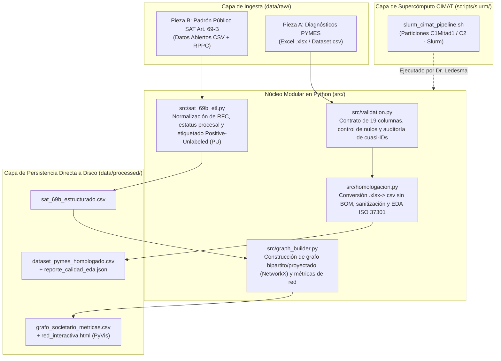

# Propuesta de Arquitectura Inicial y Flujo del Sistema

**Subequipo responsable:** Equipo de Arquitectura (`Alonzo H.S.`, `Santiago A.H.`)  
**Fecha:** 19 de octubre de 2026  

---

## 1. Visión Arquitectónica General

La arquitectura del sistema está diseñada bajo tres principios derivados de las restricciones reales del Proyecto CIMAT:
1. **Desacoplamiento entre Pieza A (Compliance PYMES) y Pieza B (Listado Público 69-B SAT):** Dos flujos de entrada independientes que comparten estándares de validación y reproducibilidad, evitando mezclar diagnósticos de vulnerabilidad con casos confirmados de fraude.
2. **Desarrollo Local $\rightarrow$ Ejecución Remota en Clúster (Patrón *Write-to-Disk*):** Dado que el acceso de ejecución al clúster del CIMAT (`proy_ai26_manuel.ledesma`) es exclusivo del investigador responsable y que el *Manual de Acceso a Recursos del CIMAT* (p. 18) prohíbe imprimir salidas por pantalla (`stdout` o redirección `>`), todos los módulos de Python escriben sus resultados y bitácoras **directamente a archivos en disco**.
3. **Escalabilidad progresiva:** El código corre en milisegundos en una laptop con los datos actuales (18 filas en Pieza A; miles de filas en Pieza B), pero queda instrumentado con scripts de **Slurm** (`sbatch`) y listas de tareas para **Proyectos Tipo 1** (`/opt/ClusterTools/MPI_Scheduler`) para escalar sin cambios de código en 2027.

---

## 2. Módulos del Sistema (`src/`) y Correspondencia con los 4 Frentes

| Módulo / Archivo | Frente | Subequipo Responsable | Función Técnica |
| :--- | :---: | :--- | :--- |
| `src/config.py` | Transversal | Arquitectura (`Alonzo H.S.`) | Define rutas relativas, constantes del estándar ISO 37301 y un manejador de bitácoras (`FileHandler`) que escribe directamente a archivo sin usar `print()` ni `stdout`. |
| `src/validation.py` | Frente 1 | Calidad (`Benny M.S.`, `Romina C.G.`) | Verifica el contrato de las 19 columnas, detecta la marca `UTF-8 BOM`, audita que cada PYME tenga sus 6 categorías ISO 37301 y levanta alertas sobre los 10 problemas de calidad. |
| `src/homologacion.py` | Frente 1 | Datos (`Santiago A.D.`, `Gerardo J.M.`) | Convierte archivos `.xlsx` o `.csv` con BOM a `UTF-8` limpio, generaliza valores exactos (`6 años`, `14 empleados`), sanitiza cuasi-identificadores en `observaciones_calidad_dato` y genera el resumen estadístico (EDA). |
| `src/sat_69b_etl.py` | Frente 2 | Datos + Requerimientos (`Gerardo J.M.`, `Mariana M.R.`) | Estructura el listado público del **Art. 69-B del SAT** (*presuntos, definitivos, desvirtuados, sentencia favorable*) y asigna pesos de evidencia bajo el enfoque *Positive-Unlabeled (PU)*. |
| `src/graph_builder.py` | Frente 3 | Arquitectura (`Santiago A.H.`, `Alonzo H.S.`) | Construye el grafo bipartito (Empresas $\leftrightarrow$ Atributos compartidos: representante legal, domicilio, socio, notario) y su proyección unimodal en `NetworkX`, calculando grado, centralidad de intermediación (`betweenness`), componentes conexas y visualización en `PyVis`. |
| `scripts/slurm/slurm_cimat_pipeline.sh` | Frente 4 | Arquitectura (`Alonzo H.S.`) | Script `sbatch` configurado para el clúster del CIMAT (partición `C1Mitad1` o `C2`), listo para ejecución desatendida por el Dr. Manuel Ledesma. |
